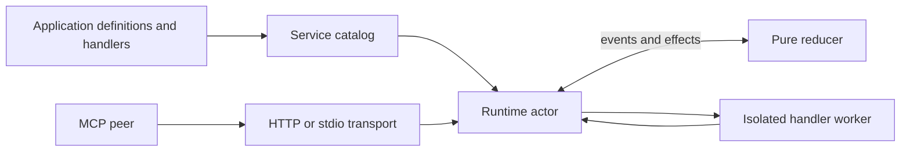

# Relay

[](https://github.com/gleam-dream/relay/actions/workflows/ci.yml)
[](https://hex.pm/packages/relay)
[](https://gleam.run/)

Relay is a Gleam MCP server and client for Erlang. It implements the frozen MCP `2026-07-28` revision over stdio and Streamable HTTP.

## Capabilities

- Typed tool definitions reused for server declarations, handlers, and client calls. Calls distinguish success, tool refusal, and a request for more input.
- Server resources and URI templates, prompts, completion, and text, image, audio, and resource content.
- HTTP and stdio servers, plus HTTP, stdio, and in-process client connections.
- Client discovery, bounded listings, calls, resource reads, prompt retrieval, completion, and notification subscriptions.
- Live tool registration and notifications to active subscribers when the catalog changes.
- Per-request context and optional bearer resource admission. The application supplies the verifier and chooses how context becomes business policy.
- Deadlines, cancellation, headers, correlation, and optional idempotency keys. Client failures retain evidence about whether a request may have been sent.

## When Relay fits

Use Relay when a Gleam application needs to expose typed operations to MCP peers, or call an existing MCP server while retaining native Gleam values and explicit failure information. Common setups are:

- An HTTP MCP endpoint exposing application operations to an agent or other remote client.
- An endpoint mounted in an existing application router, with each request supplying tenant or caller context and an application-owned verifier when bearer protection is needed.
- A local tool process launched over stdio, or an application that calls an MCP peer over HTTP or stdio.

## Install

Add Relay and JSON Blueprint from Hex; add Sinal or HTTP Gun directly when your application imports their modules or types.

```sh
gleam add relay json_blueprint@2
```

Use Gleam `>= 1.18.0` with the Erlang target. Commit `gleam.toml` and
`manifest.toml` so builds use the same resolved versions.

## Server flow and ownership

On the server, the transport admits a request to a runtime actor. The actor serializes protocol state through a pure reducer and starts isolated workers for application handlers. HTTP can build request context and ask a verifier before dispatch; stdio trusts its parent process.



## Serve and call a typed tool

This runnable example defines one typed tool and reuses its definition on both sides of a local HTTP round trip.

<!-- prettier-ignore-start -->

<!-- snips: examples/relay_usage/src/relay_usage/serve_and_call.gleam#serve-and-call -->
```gleam
import gleam/int
import gleam/io
import gleam/string
import json/blueprint/codec
import relay/client
import relay/http
import relay/server
import relay/tool

/// One `Definition` holds the input and output codecs used by both the server
/// handler and the client call.
pub fn greet() -> tool.Definition(String, String) {
  let input = {
    use name <- codec.field("name", codec.string(), get: fn(name) { name })
    codec.success(name)
  }
  tool.define("greet", input, codec.string())
  |> tool.with_description("Greets the user by name")
  |> tool.with_read_only_hint(True)
}

/// Binds an ephemeral loopback port, calls the tool and closes everything.
/// Application code handles each `Result` and closes resources it created when
/// a later operation fails.
pub fn serve_and_call() -> Nil {
  let service =
    server.new([tool.handle(greet(), fn(name) { Ok("Hello, " <> name <> "!") })])
  let assert Ok(mcp) = http.start(http.new(service))
  let url = "http://127.0.0.1:" <> int.to_string(http.port(mcp)) <> "/"

  let assert Ok(config) = client.http(url)
  let assert Ok(peer) = client.connect(config)
  let assert Ok(client.Succeeded("Hello, Ada!", _)) =
    client.call(peer, greet(), "Ada")
  client.close(peer)
  http.stop(mcp)
}

```

<!-- prettier-ignore-end -->

## Mount in an application

Use `http.handler` when the host router should own HTTP listening. The [complete example](examples/relay_usage/src/relay_usage/mount.gleam) supplies
the imports and `Tenant` type. It reads a tenant header as example input; derive
trusted tenant authority through your application's authentication and policy. This buffered interface cannot stream progress or observe client disconnects and returns 406 for `subscriptions/listen`; mount `http.mist_handler` when streaming and disconnect cancellation matter. Call `http.stop` when the mounted endpoint shuts down.

<!-- prettier-ignore-start -->

<!-- snips: examples/relay_usage/src/relay_usage/mount.gleam#mount -->
```gleam
pub fn mount(service: server.Server(Tenant)) -> http.Handler(Tenant) {
  let assert Ok(mcp) =
    http.new_with_context(service, fn(req) {
      case request.get_header(req, "x-tenant") {
        Ok(id) -> Ok(Tenant(id))
        Error(Nil) ->
          Error(response.new(400) |> response.set_body(bytes_tree.new()))
      }
    })
    |> http.with_allowed_hosts(["mcp.example.com", "127.0.0.1"])
    |> http.handler
  mcp
}

```

<!-- prettier-ignore-end -->

For bearer-protected endpoints, see the [protection recipe](examples/relay_usage/src/relay_usage/protect.gleam). Relay checks the verifier's attested resource and scopes and formats challenges and metadata; the verifier owns token authenticity, issuer, and expiry checks.

## Limits to plan for

- Only MCP `2026-07-28` is implemented. Legacy `2025-11-25` sessions, MCP client OAuth flows, tasks, resource-read continuation, and `logging/setLevel` are not implemented.
- Tool input schemas use Blueprint's finite admitted profile. Unsupported schemas are reported explicitly; Relay does not claim to accept every valid JSON Schema.
- Stdio provides no bearer authorization. Run it under a trusted parent process.
- A client error with `MaybeSent` evidence means the operation may have run. Relay never retries automatically and does not provide durable idempotency receipts; the application owns retry and reconciliation policy.
- The built-in resource-template matcher supports one simple `{name}` variable per segment. Use `resources.template_with_matcher` for other patterns.

## Learn more

- [Runnable usage recipes](examples/relay_usage/README.md)
- [Public API modules](src/relay/): `tool`, `server`, `http`, `stdio`, `client`, and `authorization`
- [Design and contracts](docs/design/design-layer.pdf)
- [Protocol and conformance evidence, including its limits](docs/ORACLE.md)
